# Docker 개발 워크스테이션 구축

## 1. 프로젝트 개요

WSL(Ubuntu) 터미널에서 Docker와 Git/GitHub로 개발 환경을 구축하는 미션입니다. 아래 순서로 진행했습니다.

- 터미널 기본 조작과 파일 권한 이해
- Dockerfile로 Flask 웹 서버 커스텀 이미지 빌드
- 포트 매핑으로 호스트 브라우저에서 컨테이너 접속
- 바인드 마운트와 Docker 볼륨으로 데이터 반영과 영속성 확인
- Git 설정, GitHub 저장소 연동, VSCode 연동

저장소 구조는 다음과 같습니다.

```
docker-workstation/
├── README.md
├── Dockerfile
├── app.py
├── requirements.txt
├── .dockerignore
└── docs/            # 검증 스크린샷
```

## 2. 실행 환경

| 항목 | 내용 |
|---|---|
| OS | Windows + WSL2 Ubuntu |
| 쉘/터미널 | bash / Windows Terminal |
| Docker 버전 | Docker version 29.9.2, build a82e528 |
| Git 버전 | git version 2.53.0 |
| Python (컨테이너) | python:3.11-slim |
| 작업 폴더 | `~/app` |

## 3. 수행 항목 체크리스트

- [x] 터미널 기본 명령 (pwd, ls -a, cd, mkdir, touch, cp, mv, rm, cat)
- [x] 파일/폴더 권한 확인과 변경 실험 (`ls -l`, `chmod` / 파일 1개, 디렉터리 1개)
- [x] Docker 설치 및 동작 확인 (`docker --version`, `docker info`)
- [x] Docker 기본 운영 명령 (`images`, `ps`, `ps -a`, `logs`, `stats`)
- [x] 컨테이너 실행 실습 (hello-world, ubuntu 진입, attach/exec 차이)
- [x] Dockerfile 작성 및 커스텀 이미지 빌드
- [x] 컨테이너 실행 및 포트 매핑 (`-p 5000:5000`)
- [x] 바인드 마운트 반영 확인
- [x] Docker 볼륨 영속성 확인
- [x] Git 사용자 정보와 기본 브랜치 설정 (`git config --list`)
- [x] GitHub 저장소 생성과 push
- [x] VSCode GitHub 로그인과 저장소 연동
- [x] 보안: 토큰, 비밀번호, 이메일은 로그와 스크린샷에서 마스킹

## 4. 웹 서버 소스와 Dockerfile

### app.py

```python
from flask import Flask

app = Flask(__name__)

@app.route('/')
def hello():
    return '''
    <h1>🐳 Docker 웹서버</h1>
    <p>안녕하세요! Flask 서버가 실행 중입니다.</p>
    '''

@app.route('/api/status')
def status():
    return {'status': 'running', 'message': '정상 작동 중'}

if __name__ == '__main__':
    app.run(host='0.0.0.0', port=5000, debug=True)
```

- `host='0.0.0.0'`: 컨테이너 밖에서도 접속할 수 있게 모든 인터페이스에서 요청을 받습니다.
- `debug=True`: 개발용 설정입니다. 파일을 수정하면 자동으로 다시 로드됩니다. 운영 환경에서는 사용하지 않습니다.

### Dockerfile

```dockerfile
FROM python:3.11-slim
WORKDIR /app
COPY requirements.txt .
COPY app.py .
RUN pip install --no-cache-dir -r requirements.txt
CMD ["python", "app.py"]
```

빌드 로그 기준 구성은 다음과 같습니다.

1. `FROM python:3.11-slim`: 가벼운 파이썬 베이스 이미지
2. `WORKDIR /app`: 컨테이너 작업 경로
3. `COPY requirements.txt .`: 의존성 파일 복사
4. `COPY app.py .`: 소스 복사
5. `RUN pip install --no-cache-dir -r requirements.txt`: Flask 설치
6. 실행 명령: `python app.py`

### 커스텀 이미지 제작 내용

- **선택한 기존 베이스**: 공식 `python:3.11-slim` 이미지(리눅스 기반 이미지 위에 기능을 추가하는 방식)
- **적용한 커스텀 포인트와 목적**

| 커스텀 포인트 | 목적 |
|---|---|
| `WORKDIR /app` | 소스가 놓일 작업 경로를 고정 |
| `requirements.txt` 먼저 `COPY` | 의존성 레이어를 캐시로 재사용해 빌드 시간 단축 |
| `pip install --no-cache-dir` | pip 캐시를 남기지 않아 이미지 크기 감소 |
| `app.py` 복사와 `python app.py` 실행 | Flask 웹 서버를 컨테이너 시작 시 자동 실행 |

- **빌드/실행 명령과 핵심 결과**: 5-3(빌드), 5-4(실행) 참고

## 5. 검증 방법과 결과

### 5-1. 터미널 기본 조작과 권한 (결과물 3번)

**기본 조작 로그**

```bash
pwd                          # 현재 위치 확인
ls -a                        # 숨김 파일 포함 목록
mkdir -p ~/practice/dir1     # 디렉터리 생성
cd ~/practice                # 이동
touch empty.txt              # 빈 파일 생성
echo "hello" > file.txt      # 파일 생성
cat file.txt                 # 파일 내용 확인
cp file.txt copy.txt         # 복사
mv copy.txt renamed.txt      # 이름 변경
mv renamed.txt dir1/         # 이동
rm file.txt                  # 삭제
rm -r dir1                   # 디렉터리 삭제
```

```
$ mkdir -p ~/practice/dir1 && cd ~/practice
$ echo "hello" > file.txt
$ ls -l file.txt
-rw-r--r-- 1 samsung samsung 6 Oct 31 17:15 file.txt
$ ls -ld dir1
drwxr-xr-x 2 samsung samsung 4096 Oct 31 17:15 dir1
```

**권한 변경 실험 (파일 1개, 디렉터리 1개)**

```bash
ls -l file.txt        # 변경 전
chmod 600 file.txt
ls -l file.txt        # 변경 후
ls -ld dir1           # 변경 전
chmod 700 dir1
ls -ld dir1           # 변경 후
```

| 대상 | 변경 전 | 변경 후 |
|---|---|---|
| 파일 `file.txt` | `-rw-r--r--` (644) | `-rw-------` (600) |
| 디렉터리 `dir1` | `drwxr-xr-x` (755) | `drwx------` (700) |

```
$ chmod 600 file.txt
$ ls -l file.txt
-rw------- 1 samsung samsung 6 Oct 31 17:15 file.txt
$ chmod 700 dir1
$ ls -ld dir1
drwx------ 2 samsung samsung 4096 Oct 31 17:15 dir1
```

`chmod 600`은 소유자만 읽기/쓰기, `chmod 700`은 소유자만 읽기/쓰기/실행이 가능하게 바꿉니다. 변경 후 그룹과 기타 사용자의 권한(`r--`, `r-x`)이 `---`로 사라진 것을 확인했습니다.

**프로젝트 파일 권한 확인**

```bash
$ ls -la
drwxr-x--- 8 samsung samsung 4096 Oct 30 18:30 ..
-rw-r--r-- 1 samsung samsung  425 Oct 30 18:33 Dockerfile
-rw-r--r-- 1 samsung samsung  385 Oct 30 18:31 app.py
-rw-r--r-- 1 samsung samsung   29 Oct 30 18:31 requirements.txt
```

- 스크린샷: 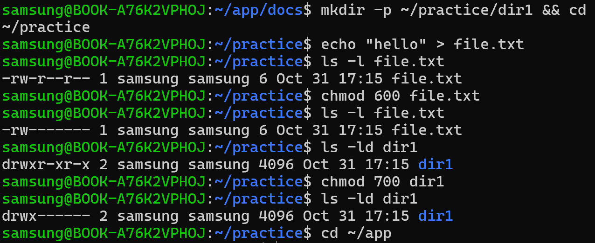

### 5-2. Docker 설치와 점검 로그 (결과물 4번)

```bash
docker --version
docker info
docker images
docker ps -a
docker logs my-flask-container
docker stats --no-stream
```

| 명령 | 확인한 내용 | 결과 |
|---|---|---|
| `docker --version` | 설치 버전 | `Docker version 29.9.2, build a82e528` |
| `docker info` | 데몬 동작 여부 | Client Version 29.9.2, Context default, 플러그인(buildx v0.38.1, compose 등) 정상 출력 |
| `docker images` | 이미지 목록 | hello-world, my-flask-app:1.0 (211MB) |
| `docker ps -a` | 컨테이너 상태 | my-flask-container `Up`, ubuntu-test `Exited (127)`, hello-world `Exited (0)` |
| `docker logs` | Flask 실행 로그 | `Running on http://172.17.0.2:5000`, `"GET / HTTP/1.1" 200` |
| `docker stats` | CPU/메모리 사용량 | CPU 0.17%, MEM 44.55MiB / 7.529GiB (0.58%), PIDS 3 |

```bash
$ docker --version
Docker version 29.9.2, build a82e528

$ docker info | head -n 5
Client:
 Version:    29.9.2
 Context:    default
 Debug Mode: false
 Plugins:

$ docker ps -a
CONTAINER ID   IMAGE              COMMAND           CREATED             STATUS                         PORTS                    NAMES
d2c357472220   my-flask-app:1.0   "python app.py"   59 minutes ago      Up 59 minutes                  0.0.0.0:5000->5000/tcp   my-flask-container
af04ab0c5aeb   ubuntu             "bash"            About an hour ago   Exited (127) About an hour ago                          ubuntu-test
3da10d0bd993   hello-world        "/hello"          About an hour ago   Exited (0) About an hour ago                            clever_rhodes
a7ea16ae3f0e   hello-world        "/hello"          23 hours ago        Exited (0) 23 hours ago                                 peaceful_lichterman

$ docker logs my-flask-container | tail -n 5
 * Running on all addresses (0.0.0.0)
 * Running on http://127.0.0.1:5000
 * Running on http://172.17.0.2:5000
172.17.0.1 - - [31/Oct/2026 07:20:27] "GET / HTTP/1.1" 200 -
 * Debug mode: on

$ docker stats --no-stream
CONTAINER ID   NAME                 CPU %     MEM USAGE / LIMIT     MEM %     NET I/O         BLOCK I/O        PIDS
d2c357472220   my-flask-container   0.17%     44.55MiB / 7.529GiB   0.58%     1.89kB / 864B   16.3MB / 172kB   3
```

- 스크린샷: 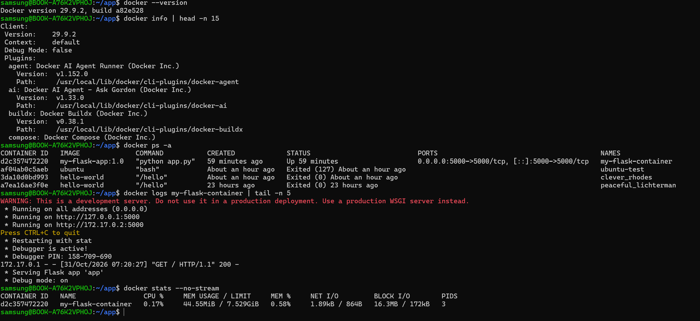

### 5-3. 이미지 빌드 (결과물 5번)

```bash
$ docker build -t my-flask-app:1.0 .
[+] Building 14.1s (11/11) FINISHED
 => [2/5] WORKDIR /app
 => [3/5] COPY requirements.txt .
 => [4/5] COPY app.py .
 => [5/5] RUN pip install --no-cache-dir -r requirements.txt
 => naming to docker.io/library/my-flask-app:1.0
```

```bash
$ docker images
IMAGE                ID             DISK USAGE   CONTENT SIZE
hello-world:latest   c567b231f656   25.9kB       9.49kB
my-flask-app:1.0     b67333c201fa   211MB        51.4MB
```

- 스크린샷: 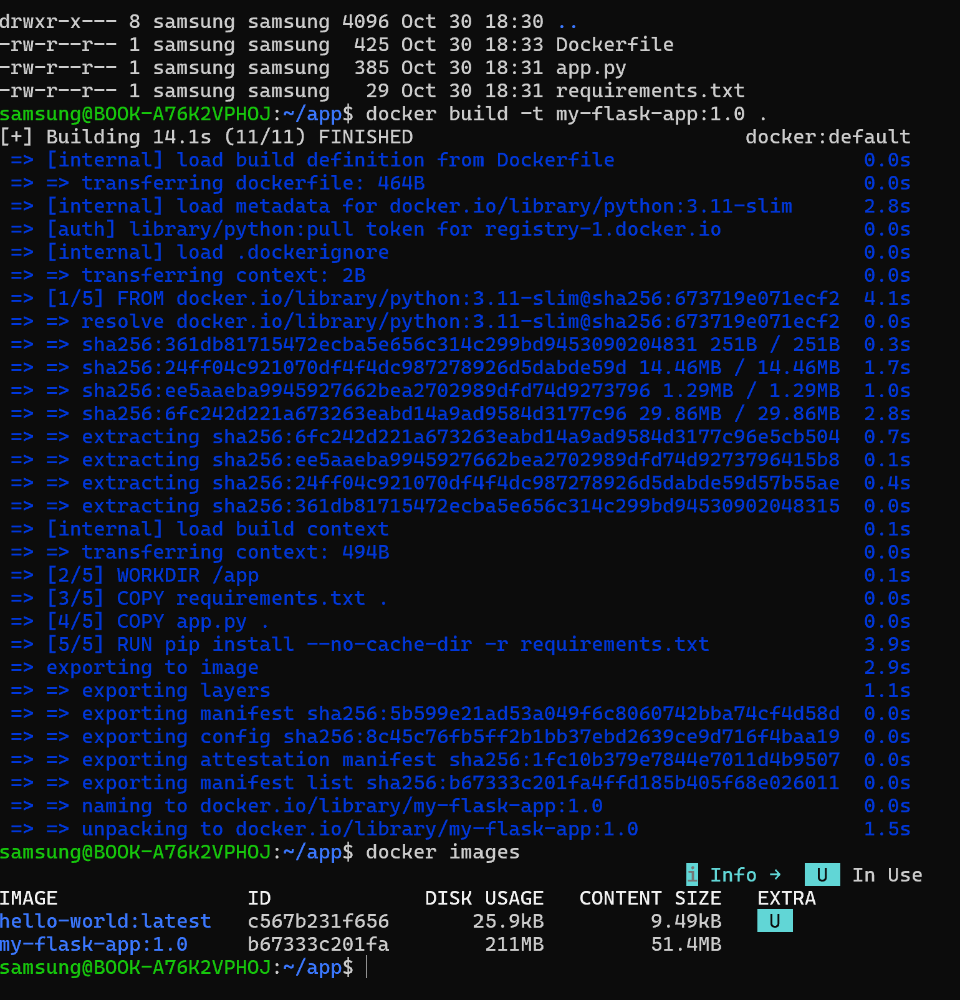

### 5-4. 컨테이너 실행과 포트 매핑 (결과물 6번)

```bash
docker run -d -p 5000:5000 --name my-flask-container my-flask-app:1.0
```

```bash
$ docker ps
CONTAINER ID   IMAGE              COMMAND            STATUS         PORTS                                         NAMES
488d0a4c638a   my-flask-app:1.0   "python app.py"    Up 2 minutes   0.0.0.0:5000->5000/tcp, [::]:5000->5000/tcp   my-flask-container
```

```bash
$ curl http://localhost:5000
<h1>🐳 Docker 웹서버</h1>
<p>안녕하세요! Flask 서버가 실행 중입니다.</p>
```

- `docker ps` 결과: 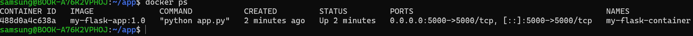
- 브라우저 접속 화면(주소창 `localhost:5000` 포함): 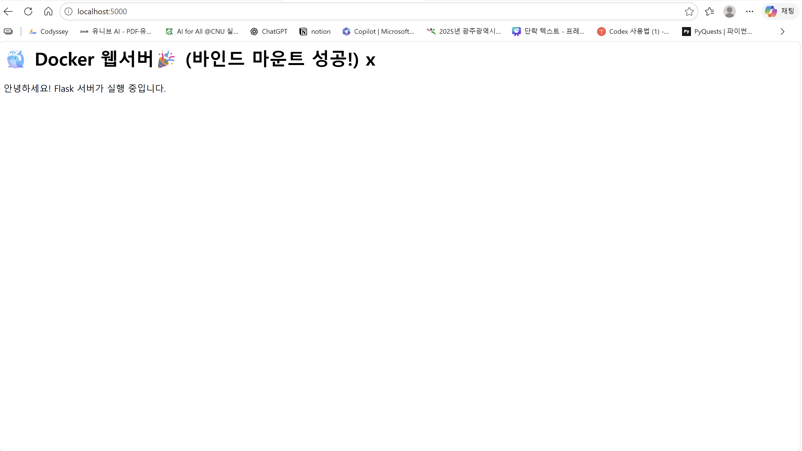

### 5-5. 바인드 마운트 (결과물 7번)

호스트의 `~/app`을 컨테이너의 `/app`에 연결했습니다.

```bash
docker rm -f my-flask-container
docker run -d -p 5000:5000 -v ~/app:/app --name my-flask-container my-flask-app:1.0
```

| 단계 | 내용 | 결과 |
|---|---|---|
| 변경 전 | `curl http://localhost:5000` | `<h1>🐳 Docker 웹서버</h1>` |
| 호스트에서 `app.py` 수정 | `<h1>` 문구에 `🎉 (바인드 마운트 성공!)` 추가 | 컨테이너 재시작 없음 |
| 변경 후 | 재시작 없이 `curl` | `<h1>🐳 Docker 웹서버🎉 (바인드 마운트 성공!) x</h1>` |

```bash
# 변경 전
$ curl http://localhost:5000
    <h1>🐳 Docker 웹서버</h1>
    <p>안녕하세요! Flask 서버가 실행 중입니다.</p>

# 호스트에서 app.py 수정 후 (컨테이너 재시작 없음)
$ curl http://localhost:5000
    <h1>🐳 Docker 웹서버🎉 (바인드 마운트 성공!) x</h1>
    <p>안녕하세요! Flask 서버가 실행 중입니다.</p>
```

호스트의 `~/app` 폴더가 컨테이너의 `/app`에 직접 연결되어 있어, 호스트에서 파일을 고치면 컨테이너 안의 파일도 같이 바뀝니다. Flask가 `debug=True`라서 파일 변경을 감지해 자동으로 다시 로드했습니다.

- 스크린샷: 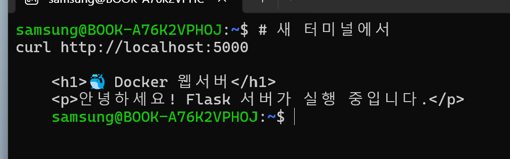 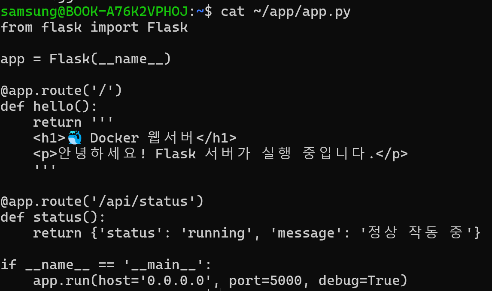 

### 5-6. Docker 볼륨 영속성 (결과물 7번)

```bash
docker volume create mydata
docker run --rm -v mydata:/data busybox sh -c "echo hello > /data/test.txt"
docker run --rm -v mydata:/data busybox cat /data/test.txt
docker volume ls
docker volume inspect mydata
```

| 단계 | 내용 | 결과 |
|---|---|---|
| 볼륨 생성 | `docker volume create mydata` | `docker volume ls`에 `local mydata` 표시 |
| 컨테이너 1에서 파일 생성 후 삭제 | `--rm`으로 컨테이너 자동 삭제 | `/data/test.txt`에 `hello` 기록 |
| 컨테이너 2에서 확인 | `cat /data/test.txt` | `hello` |
| 볼륨 정보 | `docker volume inspect mydata` | Mountpoint `/var/lib/docker/volumes/mydata/_data` |

```bash
$ docker volume ls
DRIVER    VOLUME NAME
local     mydata
$ docker run --rm -v mydata:/data busybox sh -c "echo hello > /data/test.txt"
$ docker run --rm -v mydata:/data busybox cat /data/test.txt
hello
$ docker volume inspect mydata
[
    {
        "CreatedAt": "2026-10-31T07:23:05Z",
        "Driver": "local",
        "Mountpoint": "/var/lib/docker/volumes/mydata/_data",
        "Name": "mydata",
        "Scope": "local"
    }
]
```

컨테이너가 삭제되어도 볼륨의 데이터는 남아 있음을 확인했습니다.

- 스크린샷: 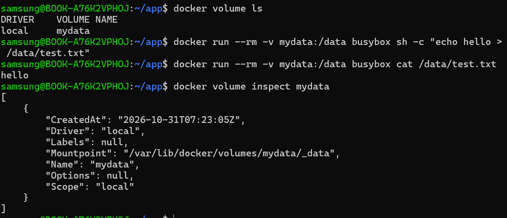

### 5-7. Git 설정과 GitHub/VSCode 연동 (결과물 8번)

```bash
git config --global user.name "eunwo030"
git config --global init.defaultBranch main
git config --list
git remote -v
```

```
$ git config --list
init.defaultbranch=main
user.name=eunwo030
user.email=***@*****.***
core.repositoryformatversion=0
core.filemode=true
core.bare=false
core.logallrefupdates=true
remote.origin.url=https://github.com/eunwo030/docker-workstation.git
remote.origin.fetch=+refs/heads/*:refs/remotes/origin/*
branch.master.remote=origin
branch.master.merge=refs/heads/master
branch.main.remote=origin
branch.main.merge=refs/heads/main

$ git remote -v
origin  https://github.com/eunwo030/docker-workstation.git (fetch)
origin  https://github.com/eunwo030/docker-workstation.git (push)
```

- 사용자 이름 `eunwo030`, 기본 브랜치 `main`, 원격 저장소 `origin` 연결을 확인했습니다. 이메일은 마스킹했습니다.

- 스크린샷: 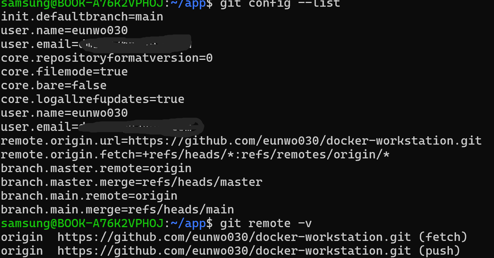
- VSCode GitHub 로그인과 저장소 연동: 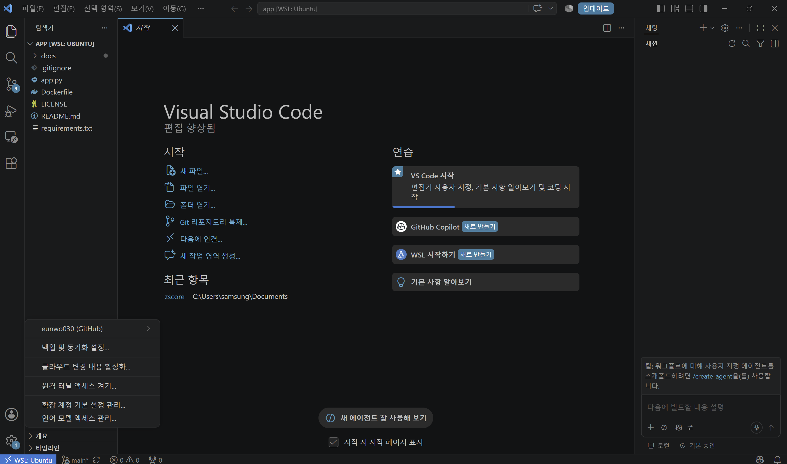

### 5-8. 컨테이너 실행 실습 (hello-world / ubuntu)

```bash
docker run hello-world
docker run -it --name ubuntu-test ubuntu bash
ls
echo "hello from ubuntu"
exit
```

```
$ docker run hello-world
Hello from Docker!
This message shows that your installation appears to be working correctly.

$ docker run -it --rm ubuntu bash
root@2ab10a5704d6:/# ls
bin   dev  home  lib64  mnt  proc  run   srv  tmp  var
boot  etc  lib   media  opt  root  sbin  sys  usr
root@2ab10a5704d6:/# echo "hello from ubuntu"
hello from ubuntu
root@2ab10a5704d6:/# exit
exit

$ docker ps -a
CONTAINER ID   IMAGE              COMMAND           CREATED             STATUS                         NAMES
95ed324599fb   hello-world        "/hello"          36 seconds ago      Exited (0) 35 seconds ago      magical_colden
d2c357472220   my-flask-app:1.0   "python app.py"   About an hour ago   Up About an hour               my-flask-container
af04ab0c5aeb   ubuntu             "bash"            About an hour ago   Exited (127) About an hour ago ubuntu-test
```

**종료/유지와 attach/exec 차이 관찰**

| 상황 | 관찰 내용 |
|---|---|
| `exit`로 나온 ubuntu 컨테이너 | `docker ps -a`에서 `ubuntu-test`가 `Exited (127)` 상태로 남았습니다. 메인 프로세스(bash)가 끝나면 컨테이너도 멈추지만 기록은 남습니다. |
| `--rm`으로 실행한 ubuntu 컨테이너 | `exit` 후 `docker ps -a`에 보이지 않습니다. 종료와 동시에 자동 삭제되었습니다. |
| `docker exec -it my-flask-container bash` | 실행 중인 컨테이너에 새 프로세스로 들어갑니다. `exit`로 나와도 `my-flask-container`는 계속 `Up` 상태였습니다. |
| `docker attach` | 컨테이너의 메인 프로세스에 직접 연결됩니다. 여기서 `exit`하면 메인 프로세스가 종료되어 컨테이너도 멈춥니다. 그래서 실행 중인 서비스 컨테이너에는 `exec`를 써야 안전합니다. |
| 컨테이너 안에서 `docker` 명령 | `bash: docker: command not found`. 컨테이너 안에는 Docker CLI가 없으므로 `docker` 명령은 호스트에서 실행해야 합니다. |

- 스크린샷: 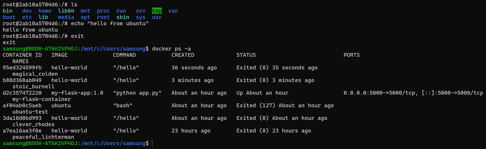

> 토큰, 비밀번호, 이메일 등 민감 정보는 모두 가렸습니다.

## 6. 트러블슈팅

### 6-1. `refusing to merge unrelated histories`

| 단계 | 내용 |
|---|---|
| 문제 | 로컬 `master`와 GitHub `main`을 합치려 하자 `refusing to merge unrelated histories` 오류가 났습니다. |
| 원인 가설 | `main`은 GitHub에서 저장소를 만들 때 생겼고, `master`는 로컬에서 `git init`으로 만들어져 서로 공통 조상 커밋이 없습니다. |
| 확인 | GitHub의 Branches 화면에서 `main`에는 `.gitignore`, `LICENSE`, `README.md`가 있고 `master`에는 `Dockerfile`, `app.py`, `requirements.txt`가 있음을 확인했습니다. `git log --oneline`으로 두 브랜치의 커밋 기록이 이어지지 않음도 확인했습니다. |
| 해결 | `git merge master --allow-unrelated-histories`로 병합한 뒤 `git push origin main`을 실행했습니다. `main`에 파일 6개가 모였습니다. |
| 재발 방지 | 로컬에서 `git init` 하기 전에 GitHub 저장소를 `git clone`하거나, `git config --global init.defaultBranch main`으로 기본 브랜치를 `main`으로 통일합니다. |

### 6-2. GitHub push 인증 실패와 토큰 문제

| 단계 | 내용 |
|---|---|
| 문제 | `git push` 때 Password 입력을 요구했지만 계정 비밀번호로는 인증이 되지 않았고, 토큰을 만들 때는 `Note has already been taken` 오류가 났습니다. |
| 원인 가설 | GitHub는 HTTPS push에 계정 비밀번호 대신 Personal Access Token(PAT)을 요구합니다. 또한 같은 Note 이름의 토큰이 이미 있었습니다. |
| 확인 | GitHub Settings → Developer settings → Tokens 목록에서 같은 이름의 토큰이 이미 있음을 확인했습니다. |
| 해결 | 다른 이름으로 `repo` 권한 토큰을 새로 만들어 Password 칸에 입력했고, push가 성공했습니다(`df86941..1bb34f3 main -> main`). |
| 보안 조치 | 토큰이 터미널 화면에 그대로 출력되어 노출되었으므로, 해당 토큰을 즉시 삭제(revoke)했습니다. 토큰은 코드, README, 스크린샷에 남기지 않습니다. |
| 대안 | `gh auth login`으로 브라우저 로그인을 하면 토큰을 직접 다루지 않아도 됩니다. |

### 6-3. 컨테이너 이름 충돌 (`Conflict. The container name is already in use`)

| 단계 | 내용 |
|---|---|
| 문제 | 바인드 마운트를 걸어 `docker run --name my-flask-container ...`를 실행하자 `Conflict. The container name "/my-flask-container" is already in use` 오류가 났습니다. |
| 원인 가설 | 같은 이름의 컨테이너가 이미 존재하면 새로 만들 수 없습니다. 같은 명령을 두 번 실행했거나, 이전 컨테이너를 지우지 않은 상태였습니다. |
| 확인 | `docker ps -a`로 `my-flask-container`가 이미 `Up` 상태로 실행 중인 것을 확인했습니다. 첫 번째 실행은 성공했고 두 번째 실행이 실패한 것이었습니다. |
| 해결 | 이미 실행 중인 컨테이너를 그대로 사용했습니다. 다시 만들어야 할 때는 `docker rm -f my-flask-container`로 지운 뒤 `docker run`을 실행합니다. |
| 재발 방지 | `docker run` 전에 `docker ps -a`로 같은 이름이 있는지 확인하고, 테스트용 컨테이너는 `--rm` 옵션으로 자동 삭제되게 합니다. |

### 6-4. 컨테이너 안에서 `docker` 명령 실행 불가

| 단계 | 내용 |
|---|---|
| 문제 | `docker exec`로 컨테이너에 들어간 상태에서 `docker rm`을 실행하자 `bash: docker: command not found`가 났습니다. |
| 원인 가설 | 프롬프트가 `root@컨테이너ID:/#`였습니다. 컨테이너 안에는 Docker CLI가 설치되어 있지 않습니다. |
| 확인 | `exit`로 나오자 프롬프트가 `samsung@BOOK-...:~/app$`로 바뀌었고, 같은 명령이 정상 실행되었습니다. |
| 해결 | 컨테이너에서 `exit`로 나온 뒤 호스트에서 `docker` 명령을 실행했습니다. |
| 재발 방지 | 프롬프트로 현재 위치를 확인합니다. `root@...:/#`는 컨테이너 안, `samsung@...$`는 호스트입니다. |

## 7. 과제 목표 정리

### 7-1. 절대 경로와 상대 경로

- **절대 경로**는 루트(`/`)부터 시작하는 전체 경로입니다. 현재 위치와 상관없이 항상 같은 파일을 가리킵니다. 예: `/home/samsung/app/app.py`, `~/app/app.py`
- **상대 경로**는 현재 위치를 기준으로 한 경로입니다. 예: 현재 위치가 `~/app`이면 `./app.py` 또는 `app.py`, 상위 폴더는 `../`
- 실습에서 `cat ~/app/app.py`는 절대 경로 방식이고, `~/app`에서 `docker build -t my-flask-app:1.0 .`의 `.`은 현재 폴더를 뜻하는 상대 경로입니다.

### 7-2. 파일 권한 (r/w/x, 755, 644)

- `r`(읽기)=4, `w`(쓰기)=2, `x`(실행)=1이고, 소유자/그룹/기타 순서로 세 자리를 씁니다.
- `-rw-r--r--` = 소유자 rw(6), 그룹 r(4), 기타 r(4) → **644**. 실습의 `Dockerfile`, `app.py`가 이 권한입니다.
- `-rwxr-xr-x` = 소유자 rwx(7), 그룹 r-x(5), 기타 r-x(5) → **755**. 실행 파일과 폴더에 주로 씁니다.
- 변경은 `chmod 755 파일명`으로 합니다.

### 7-3. 커스텀 이미지

베이스 이미지(`python:3.11-slim`) 위에 작업 디렉터리 설정, 의존성 설치, 소스 복사, 실행 명령을 Dockerfile로 정의해 `my-flask-app:1.0` 이미지를 만들었습니다. `requirements.txt`를 먼저 복사해 의존성 설치 레이어를 캐시로 재사용하게 했습니다.

### 7-4. 포트 매핑이 필요한 이유

컨테이너는 자신만의 격리된 네트워크를 가지므로, 컨테이너 안의 5000번 포트는 호스트에서 바로 접근할 수 없습니다. `-p 호스트포트:컨테이너포트`로 호스트 포트와 컨테이너 포트를 연결해야 `localhost:5000`으로 접속할 수 있습니다.

### 7-5. Docker 볼륨

컨테이너의 파일 시스템은 컨테이너를 삭제하면 사라집니다. 볼륨은 Docker가 관리하는 호스트 쪽 저장 공간으로, 컨테이너와 분리되어 있어 컨테이너를 삭제해도 데이터가 남습니다. 바인드 마운트는 호스트의 특정 경로를 직접 연결하는 방식이어서 개발 중 코드 반영에 적합하고, 볼륨은 데이터베이스 같은 영속 데이터에 적합합니다.

### 7-6. Git과 GitHub의 역할 차이

- **Git**: 내 컴퓨터에서 동작하는 분산 버전 관리 도구입니다. 변경 이력을 커밋으로 기록하고 브랜치와 병합을 관리합니다.
- **GitHub**: Git 저장소를 인터넷에 호스팅하는 원격 협업 플랫폼입니다. push/pull로 코드를 공유하고, 공개 저장소로 제출하거나 이슈, 풀 리퀘스트로 협업합니다.

## 8. 결과물 체크표

| 번호 | 결과물 | 위치 |
|---|---|---|
| 1 | 공개 GitHub 저장소 | 이 저장소 |
| 2 | 기술 문서 | 이 README |
| 3 | 터미널 조작 로그 | 5-1, 5-3, 5-4, 5-8 |
| 4 | Docker 운영/검증 로그 | 5-2, 5-8 |
| 5 | Dockerfile 웹 서버 컨테이너 | 4, 5-3 |
| 6 | 포트 매핑 접속 증거 | 5-4 |
| 7 | 바인드 마운트와 볼륨 영속성 | 5-5, 5-6 |
| 8 | Git/GitHub/VSCode 연동 | 5-7 |
